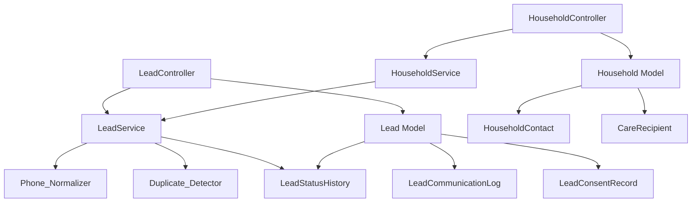

# Design Document — Module 1: CRM & Lead Management

## Overview

This module adds an end-to-end intake pipeline to the Amanah Operations Platform. It manages the full lifecycle from first contact (Lead) through qualification, consent tracking, duplicate control, and conversion into a managed Household record.

Two core aggregates drive the module:
- **Lead** — a pre-conversion prospect with status lifecycle, consent tracking, and communication history
- **Household** — a converted client family grouping HouseholdContacts and CareRecipients

The module follows all existing project conventions: Laravel 12, PHP 8.2, Blade + Livewire 3, Yajra DataTables, SoftDeletes, Spatie ActivityLog, and role-based access via `role_permission_check` middleware.

---

## Architecture



**Request flow:**
1. Controller receives request, delegates to Service for business logic
2. Service uses `PhoneNormalizer` value object for normalization
3. Duplicate detection runs before any persistence
4. DB::transaction() wraps multi-model operations (conversion, cascade delete)
5. Spatie ActivityLog dispatched on all CUD events
6. DataTable JSON branch returns via `wantsJson()` in `index()`

---

## Components and Interfaces

### Controllers

**`App\Admin\Controllers\LeadController`**
- `index()` — branches on `wantsJson()` for DataTable JSON; supports filters: status, channel, area, owner_id, date range
- `create()` / `store()` — new lead form; runs duplicate check before persisting
- `show()` — tabbed view: Details / Communication Log / Consent
- `edit()` / `update()` — edit form with duplicate re-check on phone/email changes
- `destroy()` — soft-delete
- `updateStatus($id)` — toggle is_active via POST
- `convert($id)` — delegates to `HouseholdService::convertFromLead()`

**`App\Admin\Controllers\HouseholdController`**
- `index()` — DataTable JSON branch; filters: status, area, assigned_coordinator_id, founding_cohort
- `create()` / `store()` / `edit()` / `update()` / `destroy()`
- `updateStatus($id)` — toggle is_active

**`App\Admin\Controllers\Household\HouseholdContactController`**
- `store($householdId)` / `update($householdId, $id)` / `destroy($householdId, $id)`
- Contact responsibility flags allow one person to be both Primary Decision Maker and Billing Contact. `HouseholdService` serializes assignment changes under a Household row lock and rejects changes that remove the last active required contact.

**`App\Admin\Controllers\Household\CareRecipientController`**
- `store($householdId)` / `update($householdId, $id)` / `destroy($householdId, $id)`

**`App\Admin\Controllers\Lead\CommunicationLogController`**
- `store($leadId)` — rejects Outbound if `consent_status != Granted`
- `destroy($leadId, $id)` — soft-delete

**`App\Admin\Controllers\Lead\ConsentController`**
- `store($leadId)` — creates new ConsentRecord row (append-only)
- `update($leadId, $id)` — records withdrawal timestamp; rolls up lead `consent_status`

### Services

**`App\Admin\Services\LeadService`**
```php
public function normalizePhone(string $raw): string
public function detectDuplicates(string $normalizedPhone, ?string $email, ?int $excludeId = null): Collection
public function validateTransition(string $from, string $to): bool
public function getAllowedTransitions(): array
public function recordStatusHistory(Lead $lead, string $from, string $to): void
```

**`App\Admin\Services\HouseholdService`**
```php
public function convertFromLead(Lead $lead, array $extraData = []): Household
public function guardLastPrimaryContact(Household $household, int $contactId): void
public function cascadeSoftDelete(Household $household): void
```

### Config

**`config/crm.php`**
```php
return [
    'dhaka_zones' => [
        'Dhanmondi', 'Gulshan', 'Banani', 'Uttara', 'Mirpur',
        'Mohammadpur', 'Bashundhara', 'Wari', 'Old Dhaka', 'Motijheel',
        'Tejgaon', 'Rampura', 'Badda', 'Khilgaon', 'Shyamoli', 'Other',
    ],
    'lost_reasons' => [
        'Budget Mismatch', 'Area Not Served', 'Service Not Available',
        'Unresponsive', 'Chose Competitor', 'Duplicate',
        'Not Eligible — Age', 'Not Eligible — Condition', 'Other',
    ],
    'non_clinical_keywords' => [
        // diagnoses, drug names, prescriptions — loaded from env/config
        // e.g. 'diabetes', 'hypertension', 'metformin', ...
    ],
    'age_bands' => ['0–5', '6–12', '13–17', '18–59', '60–74', '75+'],
];
```

---

## Data Models

### Migrations

**`leads`**
```
id (increments)
full_name varchar(100)
phone varchar(20)                          -- original input
normalized_phone varchar(20)              -- stripped canonical form
email varchar(254) nullable
channel enum(WhatsApp,Email,Phone,Walk-in,Referral,Web Form,Other)
service_interest varchar(500) nullable
area varchar(100) nullable
live_in_pref enum(live-in,live-out,either) nullable
preferred_start_date date nullable
budget_expectation decimal(10,2) nullable
notes text nullable                        -- max 2000 in validation
status enum(New,Contacted,Qualified,Converted,Waitlisted,Lost,Not Eligible) default New
consent_status enum(Unknown,Granted,Withdrawn) default Unknown
lost_reason varchar(100) nullable
lost_reason_notes varchar(500) nullable
waitlist_priority int unsigned nullable
override_reason varchar(500) nullable
household_id unsignedInteger nullable      -- FK: households - id
owner_id unsignedInteger nullable          -- FK: users - id
is_active boolean default true
created_by unsignedInteger nullable        -- FK: users - id
softDeletes, timestamps
```

**`lead_communication_logs`**
```
id
lead_id unsignedInteger                    -- FK: leads - id
contact_date datetime
direction enum(Inbound,Outbound)
channel enum(WhatsApp,Email,Phone,In-Person,Other)
summary varchar(1000)
next_step varchar(500) nullable
created_by unsignedInteger nullable        -- FK: users - id
softDeletes, timestamps
```

**`lead_consent_records`**
```
id
lead_id unsignedInteger                    -- FK: leads - id
channel enum(WhatsApp,Email,Phone,Walk-in,Referral,Web Form,Other)
status enum(Unknown,Granted,Withdrawn)
source varchar(200) nullable
consented_at datetime nullable
withdrawn_at datetime nullable
created_by unsignedInteger nullable        -- FK: users - id
timestamps  (no softDeletes — append-only audit)
```

**`lead_status_histories`**
```
id
lead_id unsignedInteger                    -- FK: leads - id
from_status varchar(50)
to_status varchar(50)
changed_by unsignedInteger                 -- FK: users - id
timestamps  (no softDeletes — audit table)
```

**`households`**
```
id
display_name varchar(100)
area varchar(100)
address_line text nullable                 -- sensitive; excluded from DataTable
access_notes varchar(500) nullable
primary_language enum(Bangla,English,Other)
status enum(Onboarding,Active,On Hold,Closed) default Onboarding
founding_cohort boolean default false
assigned_coordinator_id unsignedInteger    -- FK: users - id
is_active boolean default true
created_by unsignedInteger nullable        -- FK: users - id
softDeletes, timestamps
```

**`household_contacts`**
```
id
household_id unsignedInteger               -- FK: households - id
name varchar(150)
role enum(Primary,Billing,Emergency)
phone varchar(20)
email varchar(254) nullable
is_active boolean default true
softDeletes, timestamps
```

**`care_recipients`**
```
id
household_id unsignedInteger               -- FK: households - id
first_name varchar(100)
recipient_type enum(Child,Adult,Senior)
date_of_birth date nullable
age_band varchar(20) nullable
relationship varchar(100) nullable
support_notes text nullable                -- max 1000; non-clinical enforced
routines text nullable                     -- max 1000
dietary_restrictions varchar(500) nullable
is_sensitive boolean default false
created_by unsignedInteger nullable        -- FK: users - id
softDeletes, timestamps
```

### Model Classes

Each model uses `SoftDeletes`, `CommonAttributes`, `BuildsQueries`.

**`App\Admin\Models\Lead`**
```php
$fillable    = [full_name, phone, normalized_phone, email, channel, service_interest,
                area, live_in_pref, preferred_start_date, budget_expectation, notes,
                status, consent_status, lost_reason, lost_reason_notes,
                waitlist_priority, override_reason, household_id, owner_id,
                is_active, created_by]
$hidden      = [deleted_at]
$appends     = [status_badge]    // HTML badge for DataTable
casts()      = [preferred_start_date => date, budget_expectation => decimal:2,
                is_active => boolean, founding_cohort => boolean]

relationships:
  owner()              BelongsTo User
  creator()            BelongsTo User (created_by)
  household()          BelongsTo Household
  communicationLogs()  HasMany LeadCommunicationLog
  consentRecords()     HasMany LeadConsentRecord
  statusHistories()    HasMany LeadStatusHistory
```

**`App\Admin\Models\LeadCommunicationLog`**
```php
relationships: lead() BelongsTo Lead, creator() BelongsTo User
```

**`App\Admin\Models\LeadConsentRecord`**
```php
relationships: lead() BelongsTo Lead, creator() BelongsTo User
```

**`App\Admin\Models\LeadStatusHistory`**
```php
// No SoftDeletes — audit only
relationships: lead() BelongsTo Lead, changedBy() BelongsTo User
```

**`App\Admin\Models\Household`**
```php
$fillable    = [display_name, area, address_line, access_notes, primary_language,
                status, founding_cohort, assigned_coordinator_id, is_active, created_by]
$hidden      = [address_line, deleted_at]   // address_line hidden by default
relationships:
  coordinator()      BelongsTo User
  contacts()         HasMany HouseholdContact
  careRecipients()   HasMany CareRecipient
  leads()            HasMany Lead
```

**`App\Admin\Models\HouseholdContact`**
```php
relationships: household() BelongsTo Household
```

**`App\Admin\Models\CareRecipient`**
```php
relationships: household() BelongsTo Household, creator() BelongsTo User
```

### Status Transition Map

```
New         → Contacted, Lost, Not Eligible
Contacted   → Qualified, Lost, Not Eligible
Qualified   → Converted, Waitlisted, Lost, Not Eligible
Converted   → (terminal)
Waitlisted  → Qualified, Lost, Not Eligible
Lost        → (terminal)
Not Eligible → (terminal)
```

Stored in `LeadService::getAllowedTransitions()` as an associative array; not hardcoded in migration or model.

---

## Correctness Properties

*A property is a characteristic or behavior that should hold true across all valid executions of a system — essentially, a formal statement about what the system should do. Properties serve as the bridge between human-readable specifications and machine-verifiable correctness guarantees.*

### Property 1: Phone normalization round-trip equivalence

*For any* valid phone input that represents the same logical number via different formatting variants (e.g., `+8801712345678`, `01712345678`, `017-1234-5678`, `0088 017 1234 5678`), the Phone_Normalizer SHALL produce the same stored `normalized_phone` value.

**Validates: Requirements 1.2, 1.3, 2.7, 16.1, 16.5, 16.6**

---

### Property 2: Status transition validity

*For any* pair of Lead statuses `(from, to)`, the Lead_Manager SHALL accept the transition if and only if `to` appears in `getAllowedTransitions()[from]`; all other pairs SHALL be rejected with a validation error.

**Validates: Requirements 3.1, 3.2**

---

### Property 3: Outbound communication requires consent

*For any* Lead whose latest-per-channel aggregate consent is not `Granted`, an Outbound CommunicationLog entry SHALL be rejected; outbound Email/SMS SHALL additionally require that channel's latest record to be `Granted`, even if another channel remains granted.

**Validates: Requirements 5.7, 6.6**

---

### Property 4: Consent status roll-up invariant

*For any* Lead and sequence of append-only ConsentRecord events: consider only the highest-ID event per channel. If any channel's current event is `Granted`, the Lead's `consent_status` SHALL be `Granted`; if there is history but no current grant it SHALL be `Withdrawn`; if no history exists it SHALL be `Unknown`.

**Validates: Requirements 6.2, 6.3, 6.4, 6.5**

---

### Property 5: Lead-to-Household conversion preserves data

*For any* Lead in `Qualified` status, triggering a conversion SHALL produce a Household where `display_name = lead.full_name`, `area = lead.area`, `assigned_coordinator_id = lead.owner_id`, `status = Onboarding`, and a Primary HouseholdContact with `name = lead.full_name`, `phone = lead.phone`, `email = lead.email`; and the Lead's `household_id` SHALL reference the newly created Household.

**Validates: Requirements 7.1, 7.2, 7.3, 7.4**

---

### Property 6: Household always has a Primary Decision Maker and Billing Contact

*For any* persisted Household, there SHALL be exactly one active Primary Decision Maker and one active Billing Contact. One contact may hold both responsibilities; deleting, deactivating, or reassigning either last responsibility SHALL be rejected.

**Validates: Requirements 9.1, 9.6, 9.7**

---

### Property 7: CareRecipient age identification required

*For any* CareRecipient record, exactly one of `date_of_birth` (a valid past date) or `age_band` (a value from the configured picklist) SHALL be non-null; records where both are null SHALL be rejected with a validation error.

**Validates: Requirements 10.3**

---

### Property 8: Child CareRecipient is always marked Sensitive

*For any* CareRecipient where `recipient_type = Child`, the field `is_sensitive` SHALL be `true` after creation or update; any attempt to set `is_sensitive = false` on a Child recipient SHALL be overridden to `true`.

**Validates: Requirements 10.8, 12.4**

---

### Property 9: Non-clinical keywords blocked in all notes fields

*For any* notes input (Lead.notes, CareRecipient.support_notes, CareRecipient.routines, Household.access_notes) that contains a substring matching any entry in `config('crm.non_clinical_keywords')`, the system SHALL reject the input with a validation error identifying the offending field; inputs containing no matching substring SHALL be accepted.

**Validates: Requirements 11.1, 11.2, 11.3, 11.4**

---

### Property 10: Duplicate detection normalizes before comparison

*For any* new Lead submission where the `normalized_phone` matches the `normalized_phone` of an existing non-deleted Lead or Household record, the Duplicate_Detector SHALL return the conflicting record with `id`, `full_name`, `status`, and `created_at` before persisting; the same applies to case-insensitive email matches.

**Validates: Requirements 2.1, 2.2, 2.3**

---

### Property 11: DataTable response never exposes address_line

*For any* Household DataTable JSON response regardless of the authenticated User's permissions, the response payload SHALL NOT include an `address_line` column or value.

**Validates: Requirements 8.3, 14.7, 12.5**

---

### Property 12: Household cascade soft-delete

*For any* Household that is soft-deleted, all associated HouseholdContacts and CareRecipients SHALL also receive a `deleted_at` timestamp in the same database transaction; none of them SHALL appear in default (non-withTrashed) queries after the operation.

**Validates: Requirements 15.2, 15.3**

---

## Error Handling

| Scenario | Response |
|---|---|
| Validation failure (field level) | `back()->withInput()` + `flash()->error()` + `$errors` bag |
| Duplicate detected | Returns to form with duplicate data; user must choose action |
| Invalid status transition | Validation error on `status` field |
| Outbound without consent | Validation error referencing BR-020 |
| OM-only merge attempted by non-OM | HTTP 403 |
| Conversion transaction failure | `DB::rollBack()` + flash error + Lead unchanged |
| Cascade delete failure | `DB::rollBack()` + flash error |
| Non-clinical keyword detected | Validation error naming the offending field |
| Last Primary contact deletion | Validation error preventing destroy |
| Sensitive record accessed without permission | Record excluded from collection (not 403) |

All controller actions wrap mutations in `try/catch`. Multi-model operations use `DB::transaction()`. Spatie ActivityLog is dispatched inside the transaction so it rolls back on failure.

---

## Testing Strategy

### Unit Tests (example-based)

- `LeadService::normalizePhone()` — each formatting variant produces canonical output
- `LeadService::validateTransition()` — each allowed pair returns true; sample invalid pairs return false
- `LeadService::detectDuplicates()` — matching phone/email returns record; no match returns empty
- `HouseholdService::guardLastPrimaryContact()` — throws when last Primary; passes when others remain
- `HouseholdService::convertFromLead()` — correct field mapping, rollback on DB failure
- Non-clinical keyword validator — keyword present → rejected; clean text → accepted
- Channel and lost_reason enum validation examples
- RBAC: merge attempt without OM role returns 403

### Property-Based Tests

Uses [Pest](https://pestphp.com/) with [pest-plugin-faker](https://github.com/pestphp/pest-plugin-faker) generators or a dedicated PBT library (e.g., [PHPUnit Quickcheck](https://github.com/turanct/phpunit-quickcheck)). Minimum 100 iterations per property.

Each test is tagged:
```
// Feature: crm-lead-management, Property N: <property text>
```

**Property 1 test** — generate: `+8801XXXXXXXXX`, `01XXXXXXXXX`, `01X-XXXX-XXXX`, `0088 01X XXXXXXXX`; assert all normalize to same `01XXXXXXXXX` string.

**Property 2 test** — generate random `(from_status, to_status)` pairs from the Lead status enum; assert acceptance IFF pair is in allowed map.

**Property 3 test** — generate latest-per-channel consent histories; attempt Outbound logs; assert aggregate grants and exact Email/SMS grants are enforced.

**Property 4 test** — generate append-only channel consent events; assert the Lead roll-up follows the latest event for each channel.

**Property 5 test** — generate random Qualified Leads with varying field values; trigger conversion; assert Household fields match Lead fields exactly, and Lead.household_id is set.

**Property 6 test** — generate Household with random contacts; attempt to delete down to zero Primary contacts; assert final delete is rejected.

**Property 7 test** — generate CareRecipient payloads with random combinations of dob/age_band (both null, one set, both set); assert null-both is rejected, otherwise accepted.

**Property 8 test** — generate CareRecipient with `recipient_type = Child` and any `is_sensitive` value; assert stored record always has `is_sensitive = true`.

**Property 9 test** — generate notes strings with/without injected keywords from `crm.non_clinical_keywords`; assert keyword-containing inputs rejected, clean inputs accepted.

**Property 10 test** — generate Lead records; submit new Lead with same phone (different formatting) or same email (different case); assert duplicate response contains required fields.

**Property 11 test** — generate authenticated requests to Household DataTable endpoint as any user; assert `address_line` key is absent from all response rows.

**Property 12 test** — generate Household with random counts of contacts and care recipients; soft-delete the Household; assert all contacts and recipients have non-null `deleted_at`.

### Integration Tests

- Lead CRUD via HTTP (store, update, destroy, restore)
- Conversion flow: Qualified Lead → Household + HouseholdContact created
- DataTable JSON shape and filter parameters
- Spatie ActivityLog entries written on Lead and Household mutations
- ConsentRecord append-only behavior (no row overwritten)
- Cascade soft-delete persisted to DB


## Current code ownership

CRM implementation classes use `App\Admin\Controllers`, `App\Admin\Models`, and `App\Admin\Services`; CRM Blade views are under `resources/views/admin/crm`; staff routes are registered from `routes/admin.php`. Shared auth/base controller/middleware remain under `App\Http`. See `docs/CODEBASE_STRUCTURE.md`.
